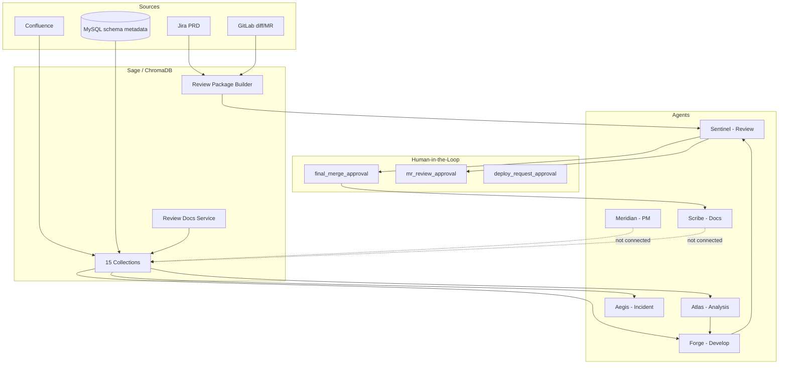

<div dir="rtl">

# Knowledge Agent و AI Multi-Agent-Driven SDLC
## بررسی فنی، مقاله، و نقدهای معماری — AgentFramework

> **پروژه:** AgentFramework  
> **Stack:** Python · FastAPI · LangGraph · ChromaDB · SQLite · Cursor CLI  
> **دامنه:** تیم .NET 8 / DDD / CQRS / Vertical Slice (پروژه Dizi)  
> **Agent دانش:** **Sage** (`src/slices/knowledge/agents/sage.py`)

---

## فهرست

1. [خلاصه اجرایی](#خلاصه-اجرایی)
2. [مقاله — ساخت AI Multi-Agent-Driven SDLC با LangGraph](#مقاله--ساخت-ai-multi-agent-driven-sdlc-با-langgraph)
3. [Knowledge Agent چیست و چه می‌کند؟](#knowledge-agent-چیست-و-چه-می‌کند)
4. [نقاط قوت (مثبت‌ها)](#نقاط-قوت-مثبت‌ها)
5. [نقاط ضعف (منفی‌ها)](#نقاط-ضعف-منفی‌ها)
6. [نقش Knowledge در AI Agent-Driven SDLC](#نقش-knowledge-در-ai-agent-driven-sdlc)
7. [مدیریت حافظه و Workflow](#مدیریت-حافظه-و-workflow)
8. [HITL — کجا و چگونه](#hitl--کجا-و-چگونه)
9. [معماری RAG و دلایل انتخاب](#معماری-rag-و-دلایل-انتخاب)
10. [نقد پروژه: چرخ از نو، ایرادها، و تکمیل SDLC](#نقد-پروژه-چرخ-از-نو-ایرادها-و-تکمیل-sdlc)
11. [نقشه Agentها و Knowledge](#نقشه-agentها-و-knowledge)
12. [جمع‌بندی و پیشنهاد مسیر بعدی](#جمع‌بندی-و-پیشنهاد-مسیر-بعدی)

---

## خلاصه اجرایی

**AgentFramework** تلاشی برای پیاده‌سازی **چرخه توسعه نرم‌افزار مبتنی بر چند Agent هوش مصنوعی** است. در مرکز این چرخه، **Knowledge Agent (Sage)** قرار دارد: یک لایه RAG مبتنی بر **ChromaDB** که دانش معماری، قوانین review، PRD، schema دیتابیس، و الگوهای کد را جمع‌آوری، ذخیره، و در اختیار Agentهای دیگر قرار می‌دهد.

**ارزش اصلی Knowledge Agent:** تبدیل دانش پراکنده (Jira، GitLab، Confluence، repo، MySQL metadata) به **Context قراردادی** برای Agentهای Atlas، Forge، Sentinel، و Aegis — به‌خصوص **Gate اجباری قبل از Code Review** (`build_review_knowledge_package`).

**وضعیت فعلی:** یک **MVP قوی برای Review + Develop + Incident** با HITL در نقاط حساس؛ هنوز **SDLC کاملاً خودکار** نیست و چند Agent (Meridian، Scribe) به Knowledge متصل نشده‌اند.

---

## مقاله — ساخت AI Multi-Agent-Driven SDLC با LangGraph

### عنوان پیشنهادی برای انتشار

**«از Chroma تا Sentinel: چگونه یک Knowledge Layer برای Multi-Agent SDLC در تیم .NET ساختیم»**

### مقدمه

تیم‌های Enterprise که روی **معماری DDD/CQRS** و **GitLab/Jira on-premise** کار می‌کنند، با چالش مشترکی روبه‌روند: LLMها بدون **Context سازمانی** کد generic تولید می‌کنند و Review آن‌ها با **استانداردهای داخلی** (namespace-first، CommandValidator sibling، و ده‌ها Rule دیگر) هم‌خوان نیست.

ما **AgentFramework** را با این فرضیه طراحی کردیم:

> *Agentها نباید هر بار از صفر «حدس» بزنند؛ باید از یک Knowledge Layer مشترک تغذیه شوند — و قبل از Merge، انسان (Tech Lead) تأیید کند.*

### معماری کلی

```
Jira (PRD) ──┐
GitLab (diff)├──► Knowledge Package ──► Sentinel Review ──► HITL ──► Merge
Chroma (rules)─┘         ▲
                         │
              Sage RAG + Ingest + DB Sync
                         │
         Atlas / Forge / Aegis (query)
```

**LangGraph** در سطح **هر Agent** (Sage، Atlas، Forge، Sentinel) یک گراف کوچک دو تا چند node دارد: مثلاً Sage = `retrieve → synthesize`. **Orchestrator سطح بالا** (`FeaturePipelineOrchestrator`) به‌صورت imperative Agentها را پشت سر هم صدا می‌زند — نه یک LangGraph بزرگ end-to-end.

### نوآوری‌های عملی (نه فقط تئوری)

1. **Review Knowledge Package** — قبل از هر MR review، PRD + Code Specs + Review Rules + diff اجباری است؛ در غیر این صورت HTTP 400.
2. **Chroma به‌عنوان Single Source of Truth** برای Review Rules، Review Skill (Cursor)، و Prompt Template — قابل ویرایش از Dashboard بدون deploy مجدد.
3. **Cursor CLI + Skill Materialization** — skill `sentinel-review` در git worktree موقت materialize می‌شود؛ diff در prompt embed است.
4. **Deterministic Fallback** — وقتی CLI خالی برمی‌گرداند، `diff_rule_scanner` قوانین RR-012/013/014 را روی diff اعمال می‌کند.
5. **MySQL Schema Sync** — فقط metadata از `information_schema` (بدون row data) برای Context codegen/review.

### درس‌هایی که گرفتیم

| درس | توضیح |
|-----|--------|
| **Agent + Workspace = کند** | `--mode agent` + `--workspace` روی worktree کامل باعث hang چند دقیقه‌ای شد؛ `ask+json` بدون workspace برای diff-only کافی است. |
| **Knowledge Gate کار می‌کند** | وقتی review بدون PRD/specs مجاز نباشد، کیفیت review قابل پیش‌بینی‌تر می‌شود. |
| **HITL ضروری است** | Merge و Deploy بدون تأیید انسان در Production قابل دفاع نیست. |
| **RAG ساده برای corpus کوچک کافی است** | top-k روی Chroma برای 15 collection curated؛ rerank هنوز لازم نبود. |

### نتیجه‌گیری مقاله

Knowledge Agent در این پروژه فقط «چت با PDF» نیست — **قرارداد Context بین Agentها** است. Sentinel بدون Knowledge فقط یک LLM reviewer است؛ با Knowledge، **بخشی از Definition of Done سازمان** را enforce می‌کند.

---

## Knowledge Agent چیست و چه می‌کند؟

### Agent: Sage

| مورد | مقدار |
|------|--------|
| **Graph** | `retrieve_knowledge` → `synthesize_answer` |
| **فایل** | `src/slices/knowledge/agents/sage.py` |
| **Service** | `src/slices/knowledge/service.py` (`KnowledgeRAGService`) |

### ۱۵ Collection در ChromaDB

| Collection | کاربرد |
|------------|--------|
| `code_patterns` | الگوهای CQRS/MediatR/Vertical Slice |
| `solutions` | راه‌حل‌های پیاده‌سازی‌شده قبلی |
| `error_patterns` | الگوهای خطا (Aegis) |
| `best_practices` | Best practices |
| `historical_context` | Context تاریخی task/MR |
| `api_reference` | UL / API docs |
| `review_rules` | قوانین Sentinel (RR-001 …) |
| `code_specs` | Code Specs پروژه |
| `review_prompt` | Template prompt review |
| `review_skill` | SKILL.md برای Cursor |
| `agent_documents` | کاتالوگ اسناد Agent |
| `architecture_spec` | Architecture Specs Dizi |
| `ubiquitous_language` | فایل‌های `*_UL.md` |
| `adr` | Architecture Decision Records |
| `database_schema` | MySQL schema (dev/stage) |

### قابلیت‌های اصلی

| قابلیت | مسیر / فایل |
|--------|-------------|
| **Query RAG** | `POST /api/v1/knowledge/query` |
| **Ingest** (GitLab, Confluence, MR) | `src/slices/knowledge/ingest/service.py` |
| **Managed Docs** (rules, skill, prompt) | `src/slices/knowledge/review_docs.py` |
| **Review Package** | `src/slices/knowledge/review_package.py` |
| **DB Schema Sync** | `src/slices/knowledge/database_sync.py` |
| **Dashboard** | `src/dashboard/static/knowledge.html` |
| **Monitoring** | `src/slices/knowledge/monitoring.py` |

### Seed Content

در اولین اجرا، `vector_store.py` اسناد seed (CQRS handler، Vertical Slice، Contract API، …) را در Chroma می‌ریزد تا dev بدون ingest فوری کار کند.

---

## نقاط قوت (مثبت‌ها)

### 1. قرارداد Knowledge برای Sentinel
- `ReviewKnowledgePackage` با validation اجباری: PRD، code_specs، review_rules، MR diff.
- `KnowledgePackageError` با لیست `missing` — UX شفاف در Dashboard/API.

### 2. Chroma به‌عنوان منبع واحد Runtime
- Review Rules / Skill / Prompt از Dashboard قابل CRUD؛ sync skill از rules (`POST /review-skill/sync-from-rules`).
- Legacy filesystem scan با HTTP 410 غیرفعال شده — کاهش drift.

### 3. Domain-Aligned Content
- Seed و default rules متناسب Dizi: RR-012 namespace-first، RR-013 CommandValidator، RR-014 trailing blank.
- Tech stack label: .NET 8, Onion, CQRS, FluentValidation.

### 4. Embedding Fallback هوشمند
- OpenAI-compatible (`text-embedding-3-small`) وقتی API key معتبر است.
- `all-MiniLM-L6-v2` (Chroma default) برای dev/local proxy — بدون وابستگی به embedding API.

### 5. Database Sync امن
- فقط `information_schema` — بدون داده سطر.
- Lock per-environment، doc ID پایدار (SHA256)، purge stale docs.

### 6. Vertical Slice Architecture
- `slices/knowledge/` جدا از `feature_pipeline`، `incident_response`.
- Agentها از `IntegrationContainer.knowledge` (Protocol) استفاده می‌کنند — mock/real قابل تعویض.

### 7. Observability
- هر query/ingest/sync → `AgentRunRecord` + events در SQLite.
- Langfuse `trace_config()` روی LangGraph agents.
- Dashboard monitoring: runs, collections, events.

### 8. Cursor Integration عمیق
- Worktree + skill materialization.
- `diff_rule_scanner` deterministic + LLM review.
- SSE live steps در Dashboard review.

### 9. Ingest Pipeline
- GitLab path classifier → collection مناسب.
- Confluence، post-merge MR، Dizi-main scan.

### 10. HITL در Gateهای معنادار
- Merge، MR Review، Deploy — نه HITL روی هر log line.

---

## نقاط ضعف (منفی‌ها)

### 1. بدون LangGraph Checkpointing
- همه graphها `.compile()` بدون `checkpointer` / `MemorySaver`.
- Resume وسط workflow ممکن نیست؛ state فقط در `output_payload` SQLite.

### 2. دو منبع Spec (Chroma vs Filesystem)
- API می‌گوید Chroma source of truth؛ `ArchitectureSpecService` هنوز filesystem دارد.
- `develop_workflow` baseline filesystem + RAG — inconsistency.

### 3. RAG ساده (Naive)
- Per-collection query → merge → sort by distance.
- بدون MMR، rerank، hybrid (BM25 + vector)، metadata filter (task_key).

### 4. پوشش تست Knowledge کم
- عمدتاً `test_review_docs_chroma.py`، `test_database_sync.py`.
- بدون integration test برای Sage graph، review package، ingest.

### 5. Singleton Services
- `_service` globals در `knowledge.py`؛ `get_knowledge_store()` با `@lru_cache` — سخت برای test isolation.

### 6. Agentهای بدون Knowledge
- **Meridian** (PM/PRD): به Chroma نمی‌نویسد/نمی‌خواند.
- **Scribe** (Confluence): post-merge docs بدون RAG.

### 7. Context Size ناقص
- `CURSOR_REVIEW_INCLUDE_SPECS=false` — PRD/specs در prompt review محدود (TODO در `context_builder.py`).

### 8. External Knowledge API Mismatch
- `RealKnowledgeService` → `/api/v1/query`؛ local API → `/api/v1/knowledge/query`.

### 9. امنیت
- CORS باز، بدون auth/RBAC روی API — برای Production ناکافی.

### 10. Ephemeral SSE Logs
- Review steps live ذخیره نمی‌شوند (فقط `output_payload` run).

### 11. Technical Debt دیگر
- README ممکن است merge conflict داشته باشد (بررسی قبل از publish).
- JSON extraction از LLM با regex در Atlas/Aegis — fragile.

---

## نقش Knowledge در AI Agent-Driven SDLC

### 1. On-Board نفرات جدید

**Knowledge چه کمکی می‌کند:**

| مکانیزم | اثر On-Boarding |
|---------|-----------------|
| **Sage Q&A** | Developer تازه‌وارد سوال می‌پرسد: «CommandHandler چطور بنویسم؟» → RAG از `code_patterns` + `best_practices` |
| **Review Rules در Chroma** | قوانین RR-xxx readable و searchable — جایگزین «بپرس از فلان نفر» |
| **Ubiquitous Language** | واژگان دامنه (Vendor، Contract، …) متمرکز |
| **Architecture Spec + ADR** | تصمیمات معماری document شده، نه oral tradition |
| **Database Schema collection** | schema dev/stage بدون دسترسی مستقیم به DB |

**محدودیت فعلی:** مسیر guided onboarding (tutorial workflow، quiz، progress tracking) وجود ندارد — فقط query آزاد.

---

### 2. در اختیار گذاشتن Context برای Agentهای دیگر

```
IntegrationContainer.knowledge
        │
        ├── Atlas    → get_architecture_context(task, PRD)
        ├── Forge    → query(subtask) + develop_workflow architecture RAG
        ├── Sentinel → build_review_knowledge_package() [کامل‌ترین]
        └── Aegis    → query(incident text) → error_patterns, solutions
```

**Sentinel — غنی‌ترین مصرف:**

```text
PRD (Jira attachment)
+ code_specs, review_rules, architecture_specs, adr, UL (Chroma)
+ git diff (GitLab)
+ review_skill (Cursor SKILL.md)
→ ReviewContext → Cursor CLI prompt
```

**Forge:** subtask title/description → vector query + architecture baseline.

**Atlas:** PRD + architecture context برای decompose به subtask.

---

### 3. مدیریت حافظه و Workflow

#### دو لایه حافظه

| لایه | تکنولوژی | Scope | ماندگاری |
|------|----------|-------|----------|
| **Semantic Memory** | ChromaDB 15 collection | سازمانی / cross-run | Persistent (`./data/chroma`) |
| **Episodic Memory** | SQLite `AgentRunRecord` + events | per run | Persistent |
| **LangGraph State** | TypedDict per agent | per `ainvoke()` | **Ephemeral** |

#### Workflow Types (SQLite)

`knowledge_query`, `knowledge_ingest`, `feature_development`, `code_development`, `mr_code_review`, `incident_response`, `deploy_request`, `prd_workflow`

#### الگوی Orchestration

- **Pipeline-level:** `FeaturePipelineOrchestrator` — sequential: Atlas → Forge → Sentinel → HITL → (Scribe).
- **Agent-level:** LangGraph 2–4 node — state داخلی graph بعد از `ainvoke` از بین می‌رود؛ فقط `output_payload` در run ذخیره می‌شود.

**نتیجه:** «حافظه workflow» = **audit trail در SQLite + vector store** — نه conversation memory LangGraph-native.

---

### 4. HITL — کجا و چگونه

| Checkpoint | Trigger | فایل / مسیر |
|------------|---------|-------------|
| **`final_merge_approval`** | Feature pipeline بعد از Sentinel MR + review | `orchestrator.py` |
| **`mr_review_approval`** | Dashboard MR Review | `gitlab_mr_service.py` |
| **`deploy_request_approval`** | Deploy request workflow | `deploy_request/orchestrator.py` |

**مکانیزم:**
1. `HITLRepository.create_checkpoint()` با `context` (MR URL، findings، task_key).
2. Run status → `WAITING_HITL`.
3. `POST /api/v1/hitl/{id}/resolve` — actions: `approve`, `reject`, `request_changes`.
4. **نه** LangGraph `interrupt()` — pause/resume application-level.

**Knowledge + HITL:** context checkpoint شامل `review.findings` و `review_prompt` است — Tech Lead با همان Knowledge Package review‌شده تصمیم می‌گیرد.

---

### 5. معماری RAG و دلایل انتخاب

#### Stack

| Component | انتخاب |
|-----------|--------|
| Vector DB | **ChromaDB** `PersistentClient` |
| Embeddings | OpenAI-compatible **یا** Chroma `DefaultEmbeddingFunction` (MiniLM) |
| Chunking | `RecursiveCharacterTextSplitter` — 800 char, overlap 100 |
| Retrieval | Per-collection `query(n_results=top_k)` → global sort by score |
| Synthesis | Sage LLM (temp 0.1)؛ fallback raw chunks اگر LLM fail |

#### چرا Chroma (نه Pinecone/Weaviate/Qdrant)?

- **On-prem friendly** — بدون SaaS vector DB جدا.
- **Operational simplicity** — یک process، `./data/chroma` روی disk.
- **Python-native** — هم‌خوان FastAPI/LangChain ecosystem.
- **Corpus کوچک curated** — 15 collection با doc count محدود؛ latency قابل قبول.

#### چرا Chunk 800 / Overlap 100?

- تعادل بین context window LLM و granularity برای markdown/code spec.
- Managed docs (rules, skill) با `split=False` — یک chunk کامل.

#### چرا بدون Rerank?

- هزینه عملیاتی کمتر.
- corpus seed + ingest controlled — noise کمتر از web-scale RAG.
- **ریسک:** recall پایین وقتی collection بزرگ شود — rerank/cross-encoder مرحله بعد.

#### چرا Multi-Collection (نه یک index)?

- **Routing معنادار:** review_rules جدا از code_patterns.
- **Managed CRUD** per kind در Dashboard.
- **Agent-specific query:** Aegis فقط error_patterns/solutions؛ Sentinel full package.

---

## نقد پروژه: چرخ از نو، ایرادها، و تکمیل SDLC

### چه چیزهایی «چرخ از نو» است (Reinvented Wheel)

| مورد | جایگزین استاندارد | توصیه |
|------|-------------------|--------|
| HITL دستی SQLite | LangGraph `interrupt` + checkpointer | migrate تدریجی برای resume |
| Run repository custom | LangSmith / Langfuse run store | Langfuse tracing دارید؛ run store را extend کنید |
| Multi-collection merge دستی | LangChain `EnsembleRetriever` | refactor وقتی collection > 50k chunk |
| JSON parse با regex | Structured output / `with_structured_output` | Atlas, Aegis |
| Orchestrator imperative | LangGraph supervisor pattern | وقتی pipeline پیچیده‌تر شد |

### چه چیزهایی ارزش Custom دارد (نگه دارید)

- `ReviewDocsService` + managed kinds
- `build_review_knowledge_package` + gate
- `DatabaseKnowledgeSyncService` (schema-only)
- Cursor review stack (worktree, skill, diff scanner)
- `IntegrationContainer` + mock matrix برای rollout تدریجی on-prem

### چه چیزهای باید باشد تا SDLC «کامل» شود

| Gap | وضعیت | اولویت |
|-----|--------|--------|
| **Auto-fix loop** | `request_changes` → Forge دوباره نمی‌زند | بالا |
| **Test Agent** | unit/integration test generate + run | بالا |
| **CI Agent** | pipeline fail → diagnose → fix MR | بالا |
| **Meridian → Chroma** | PRD ingest به knowledge | متوسط |
| **Scribe + RAG** | post-merge docs از historical_context | متوسط |
| **Scheduled ingest** | webhook/cron برای GitLab/Jira | متوسط |
| **Cross-run agent memory** | beyond `historical_context` manual | متوسط |
| **Security review agent** | SAST/dependency scan integration | متوسط |
| **RAG eval** | recall/precision metrics | پایین (تا scale) |
| **Auth/RBAC** | API + Dashboard | بالا برای prod |
| **Unified spec source** | Chroma-only architecture specs | متوسط |
| **Post-deploy smoke agent** | بعد از deploy HITL | پایین |

### ماتریس بلوغ AgentFramework

```
Planning (Meridian)     ████░░░░░░  40%  — PRD بدون Knowledge write
Analysis (Atlas)        ██████░░░░  60%  — RAG architecture
Development (Forge)     ███████░░░  70%  — Cursor + knowledge query
Review (Sentinel)       ████████░░  80%  — Knowledge gate + CLI + HITL
Knowledge (Sage)        ████████░░  80%  — RAG + ingest + review docs
Documentation (Scribe)  ███░░░░░░░  30%  — بدون RAG
Incident (Aegis)        ██████░░░░  60%  — error RAG
Deploy                  █████░░░░░  50%  — HITL only
Orchestration           ██████░░░░  60%  — sequential, no checkpoint
```

---

## نقشه Agentها و Knowledge



---

## جمع‌بندی و پیشنهاد مسیر بعدی

### آنچه ساختید ارزشمند است

یک **Knowledge Layer قراردادی** که SDLC را از «چت با Copilot» به **Multi-Agent pipeline با Gate، Audit، و HITL** نزدیک می‌کند. برای تیم .NET on-prem با GitLab/Jira، این ترکیب **عملی‌تر از SaaS-only agent platforms** است.

### سه اقدام فوری برای publish-ready

1. **یکپارچه‌سازی Spec** — حذف drift filesystem/Chroma.
2. **Meridian → ingest PRD به Chroma** — بستن حلقه Planning → Knowledge.
3. **Auth + README تمیز** — قبل از open-source یا مقاله public.

### سه اقدام برای SDLC «کامل»

1. **Auto-fix loop:** HITL `request_changes` → Forge branch update → Sentinel re-review.
2. **Test Agent** در pipeline بین Forge و Sentinel.
3. **LangGraph checkpointer** برای resume بعد از HITL یا CLI timeout.

---

## پیوست — مسیرهای کلیدی سورس

```text
src/slices/knowledge/
  agents/sage.py              # Sage LangGraph
  rag/vector_store.py         # Chroma + chunking + seed
  review_docs.py              # Managed review artifacts
  review_package.py           # Sentinel knowledge gate
  database_sync.py            # MySQL → Chroma
  ingest/service.py           # GitLab/Confluence/MR ingest

src/shared/integrations/
  local_knowledge_service.py  # Protocol adapter
  factory.py                  # use_local_knowledge

src/slices/feature_pipeline/
  orchestrator.py             # Atlas→Forge→Sentinel→HITL
  agents/sentinel.py          # MR review agent

src/api/routes/knowledge.py   # ~40 knowledge endpoints
src/dashboard/static/knowledge.html

docs/SENTINEL_REVIEW_FLOW.md
```

---

*نسخه سند: 2026-07-30 — بر اساس بررسی سورس AgentFramework*
</div>