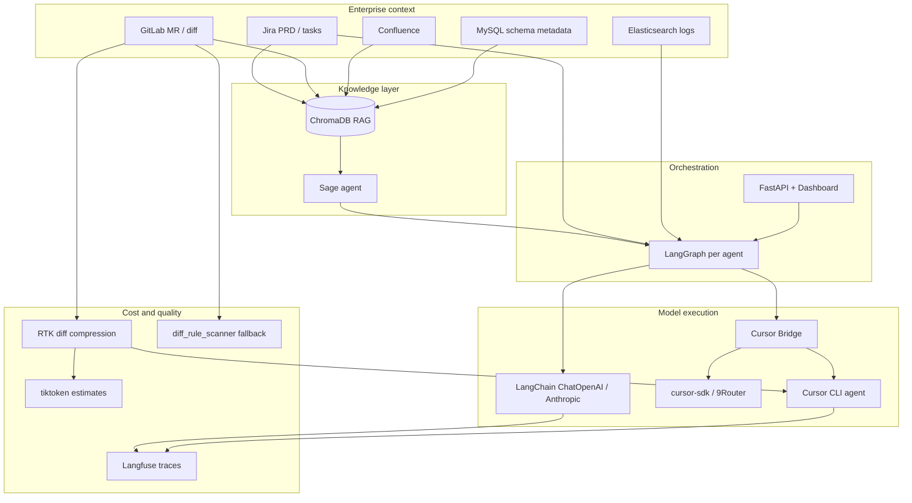

# AI Tools and Stack — AgentFramework

This document describes **which tools power AI workflows** in AgentFramework, **what each one is for**, **why the project chose it over common alternatives**, and **where it appears in the codebase**.

AgentFramework is a multi-agent SDLC orchestrator for on-premise .NET teams. AI is used for planning, implementation, code review, QA artifact generation, knowledge retrieval, and incident analysis—not as a single chatbot, but as a **pipeline of specialized agents** with human approval gates (HITL).

---

## AI process map

**High-level flow**

| Scenario | Agents | Primary AI execution |
|----------|--------|----------------------|
| Feature development | Atlas → Forge → Sentinel → HITL → Scribe | LangGraph + LangChain LLM; Forge/Sentinel often **Cursor Bridge** |
| MR code review (dashboard) | Sentinel | **Knowledge package** (Chroma + Jira) → **RTK** (optional) → **Cursor CLI** |
| Branch QA | QA | Git diff + templates → Cursor Bridge or API LLM |
| Knowledge / RAG | Sage | Chroma retrieval + LangChain synthesis |
| Incident response | Aegis | Elasticsearch context + LangGraph LLM |

Related deep dives: [SENTINEL_REVIEW_FLOW.md](./SENTINEL_REVIEW_FLOW.md), [RTK_REVIEW.md](./RTK_REVIEW.md), [QA_AGENT_GUIDE.md](./QA_AGENT_GUIDE.md), [LANGFUSE_SETUP.md](./LANGFUSE_SETUP.md).

---

## Tool catalog (quick reference)

| Tool | Role in AI | Main modules |
|------|------------|--------------|
| **LangGraph** | Stateful agent graphs (nodes, edges, message history) | `src/slices/feature_pipeline/agents/*`, `src/slices/incident_response/agents/aegis.py`, `src/slices/knowledge/agents/sage.py` |
| **LangChain** | LLM adapters, RAG glue, Langfuse callbacks | `src/shared/llm/factory.py`, `src/core/tracing.py` |
| **OpenAI / Anthropic APIs** | Cloud LLM when executor is `openai` or `claude` | `src/shared/llm/factory.py`, `.env` models |
| **Cursor CLI (`agent`)** | Local review subprocess with JSON output | `src/shared/cursor_cli/runner.py`, `response_parser.py` |
| **Cursor Bridge** | HTTP sidecar: develop, review, QA on a real git clone (Windows-friendly) | `src/cursor_bridge/server.py`, `src/shared/agent_executors/cursor_client.py` |
| **cursor-sdk** | Programmatic local agent for **develop** on repo | `src/cursor_bridge/server.py` (`Agent.create`) |
| **ChromaDB** | Vector store for RAG and **runtime** review docs | `src/slices/knowledge/rag/vector_store.py` |
| **OpenAI embeddings** (or Chroma default) | Chunk embedding for retrieval | `vector_store.py` |
| **langchain-text-splitters** | Chunking on ingest | `RecursiveCharacterTextSplitter` in `vector_store.py` |
| **tiktoken** | Token estimates (`cl100k_base`) | `src/shared/utils/token_count.py` |
| **RTK** | External diff compression before prompts | `src/shared/cursor_cli/rtk_compress.py` |
| **Langfuse** | Traces, sessions (`run_id`), cost/latency | `src/core/tracing.py` |
| **diff_rule_scanner** | Deterministic RR-012/013/014 on **raw** diff | `src/shared/cursor_cli/diff_rule_scanner.py` |
| **Pydantic** | Structured agent I/O and API contracts | Throughout `src/shared/models`, executors, QA/review models |
| **FastAPI** | REST, SSE review streams, dashboard backend | `src/main.py`, `src/api/` |

Integrations (Jira, GitLab, Confluence, Elasticsearch, Mattermost) are not LLMs; they **feed context** into the tools above.

---

## Orchestration and application layer

### LangGraph

**Use:** Each agent (Atlas, Forge, Sentinel, Scribe, Sage, Aegis, develop workflow) is a **small StateGraph**: retrieve → act → synthesize, with optional tool-style steps encoded as nodes.

**Why not CrewAI, AutoGen, or a single mega-graph?**

- **LangGraph** fits **explicit state** and **checkpoints** per agent, which matches HITL and audit (`run_id`, event logs) without forcing one global graph for the whole SDLC.
- The **top-level pipeline** stays imperative (`FeaturePipelineOrchestrator`) so teams can reorder gates (e.g. knowledge-required review) without recompiling a giant graph.
- LangGraph is the stack already declared in the product README and aligns with LangChain tracing.

**Advantages:** Clear per-agent boundaries; easy to test one graph; works with Langfuse `RunnableConfig` via `trace_config()`.

### FastAPI + Uvicorn

**Use:** HTTP API, dashboard static UI, **SSE** for live MR review steps, Cursor Bridge as a sibling service.

**Why not Django/Flask alone?**

- Async-friendly integration with httpx (GitLab, Jira, Bridge).
- Native OpenAPI for internal tooling and dashboard clients.

**Advantages:** Low ceremony; SSE for long-running review visibility without persisting noisy CLI logs to DB by default.

---

## LLM access and agent executors

### LangChain (`ChatOpenAI`, `ChatAnthropic`)

**Use:** Factory in `create_llm()`, `create_coding_llm()`, `create_code_review_llm()`, `create_pm_llm()` for agents when the executor is API-based.

**Why not raw HTTP to each provider?**

- One interface for Atlas/Forge/Sage/Aegis nodes.
- **Langfuse `CallbackHandler`** hooks in uniformly.
- Switching `LLM_PROVIDER` or per-role models (`CODING_MODEL`, `CODE_REVIEW_MODEL`, `PM_MODEL`) stays configuration-driven.

**Why not only LangChain Agents (ReAct) everywhere?**

- SDLC steps are **workflow-defined** (branch, MR, HITL), not open-ended tool loops; LangGraph + fixed executors reduces runaway tool use and cost.

**Advantages:** Provider swap without rewriting agents; consistent temperature defaults (e.g. 0.0 for review).

### OpenAI-compatible APIs and Anthropic

**Use:** Default path for PM/analysis agents and fallback when Forge/Sentinel executors are `openai` or `claude`.

**Why keep both providers?**

- Enterprise teams often standardize on one vendor; `AgentExecutorType` and env allow **Cursor for coding** and **Claude/OpenAI for lighter steps**, or full API mode without Cursor installed.

**Advantages:** Works in CI or Linux servers where Cursor desktop is absent.

### Cursor CLI (`agent` / `cursor-agent`)

**Use:** Sentinel **MR review**: prompt embeds diff + rules + specs; modes such as `ask` vs `agent`, JSON output contract (`prompt_builder.py`, `response_parser.py`).

**Why not review-only via Chat Completions?**

- Review needs **stable JSON**, model routing (e.g. Composer), and alignment with **Cursor Skills** materialized in a git worktree (`review_workspace.py`).
- The team already develops in Cursor; the CLI reuses the same agent runtime and models as the IDE.

**Why not GitHub Copilot Code Review or generic “LLM + diff” SaaS?**

- On-prem GitLab/Jira, **custom RR-xxx rules**, and **Chroma-managed** prompts/skills are first-class; an external SaaS rarely encodes Dizi/DDD/CQRS gates or Persian/English review language toggles.

**Advantages:** Diff-in-prompt without loading full workspace when `CURSOR_CLI_REVIEW_USE_WORKSPACE=false` (latency lesson documented in ops); skill checklist from Chroma.

### Cursor Bridge + cursor-sdk (+ optional 9Router)

**Use:**

- **Develop:** `cursor_bridge_develop` → SDK `Agent.create` on `CURSOR_REPO_PATH`, or 9Router when configured.
- **Review / QA:** subprocess CLI or bridge endpoints with git-aware paths on Windows.

**Why a separate Bridge service?**

- Main API may run in Docker/Linux while **the canonical clone** lives on a developer machine (`CURSOR_REPO_PATH`).
- Avoids path-length and shell limits on Windows (`runner.py` documents command-line length caps).

**Advantages:** Real git operations and Cursor auth stay on the workstation; AgentFramework stays a central orchestrator.

---

## Knowledge and RAG (Sage)

### ChromaDB + langchain-chroma

**Use:** Fifteen curated collections (review rules, code specs, review prompt/skill, ADR, UL, schema, patterns, etc.). Sentinel **must** load review package from Chroma + Jira—not from ad hoc files at review time.

**Why not Pinecone, Weaviate, or pgvector alone?**

- **Embedded persistent store** under `KNOWLEDGE_CHROMA_PATH`—no extra cluster for MVP on-prem.
- Corpus is **small and curated** (rules, specs, seeds); ops cost beats managed vector SaaS.
- Dashboard CRUD for rules/skill/prompt without redeploy.

**Why not “put everything in the prompt” or Confluence-only?**

- Rules and specs change often; RAG + managed docs avoid multi-megabyte static prompts and keep **single source of truth** in Chroma.

**Advantages:** Works offline; seed documents for local dev; collections map to product concepts (review vs architecture vs schema).

### Embeddings: OpenAI `text-embedding-3-small` vs Chroma default

**Use:** `OpenAIEmbeddingFunction` when a valid API key and remote base URL exist; otherwise **DefaultEmbeddingFunction** for local proxies (e.g. 9Router / localhost).

**Why not always local sentence-transformers?**

- Optional dependency simplicity in `pyproject.toml`; Chroma default covers dev without GPU.
- Production can point embeddings at the same OpenAI-compatible gateway as chat models.

**Advantages:** One config surface (`EMBEDDING_MODEL`, `LLM_BASE_URL`).

### RecursiveCharacterTextSplitter

**Use:** Splits ingested documents into retrieval-sized chunks.

**Why not semantic-only chunking?**

- Predictable chunk sizes for rules and markdown specs; cheap and sufficient at current scale (no reranker required yet—see KNOWLEDGE doc).

**Advantages:** Standard LangChain splitter; easy to tune per collection later.

### MySQL schema sync (metadata only)

**Use:** `information_schema` → Chroma `database_schema` for codegen/review context.

**Why not RAG over live query results?**

- Privacy and scope: **no row data**, only schema for LLM context.

---

## Token economy and review reliability

### tiktoken (`cl100k_base`)

**Use:** `count_text_tokens()` for prompt sizing, RTK before/after metrics, GitLab MR service `prompt_tokens`.

**Why not `len(text)//4` or Hugging Face tokenizers?**

- **cl100k_base** matches GPT-4 / many OpenAI-compatible billing estimates used in enterprise.
- tiktoken is fast, pure Python wheel, no model download.

**Why not provider-reported usage only?**

- Cursor CLI and compressed diffs need **pre-call estimates** and dashboard savings before the model runs.

**Advantages:** Consistent RTK `savings_pct` and API metrics (`tests/test_token_count.py`).

### RTK (Rust Token Killer)

**Use:** Optional compression of MR/git diff in review prompts; **raw diff retained** for `diff_rule_scanner`.

**Why not only internal truncation (`CURSOR_REVIEW_RTK_MAX_CONTEXT_LINES`)?**

- RTK applies filtering, dedup, and grouping tuned for shell/git output; internal fallback still runs when `rtk` is missing.

**Why not drop diff and use workspace-only agent?**

- Full workspace + agent mode caused **multi-minute hangs**; diff-in-prompt + RTK targets the largest controllable token slice.

**Advantages:** Measurable savings persisted (`RtkSavingsRepository`); see [RTK_REVIEW.md](./RTK_REVIEW.md).

### diff_rule_scanner (deterministic fallback)

**Use:** When Cursor CLI returns empty/placeholder JSON, enforce RR-012 (namespace-first), RR-013 (CommandValidator sibling), RR-014 (EOF newline) on **uncompressed** diff.

**Why not second LLM pass?**

- Deterministic rules are **cheaper, auditable, and repeatable**; avoids double spend on failure modes.

**Advantages:** Review still produces actionable findings when the model shell fails; complements rather than replaces LLM review.

### Review prompt builder and Chroma templates

**Use:** `build_review_prompt()` / skill prompts; managed template placeholders `{prd}`, `{code_specs}`, `{diff}`, `{review_rules}`, etc.

**Why not hard-coded prompts in code only?**

- Tech leads edit rules and templates in the dashboard; code supplies structure and JSON contract.

---

## Observability and persistence

### Langfuse

**Use:** Optional tracing: LangChain callbacks, session id = `run_id`, manual generations from Bridge (`GenerationTimer`, `record_generation`).

**Why not LangSmith-only or custom logs?**

- **Self-host or cloud**, open ecosystem, cost/latency dashboards without tying traces to a single LLM vendor.
- Fits both LangGraph LLM calls and Bridge-side Cursor runs.

**Advantages:** Per-agent-run investigation; see [LANGFUSE_SETUP.md](./LANGFUSE_SETUP.md).

### SQLite (aiosqlite) + SQLAlchemy

**Use:** Agent runs, HITL checkpoints, RTK savings records—not an AI model, but **audit trail** for every AI step.

**Why not store full prompts in DB for every review?**

- Live CLI output is streamed to UI; persisted payloads hold summary/results for restore, controlling storage and secret leakage.

---

## QA Agent (Branch QA)

**Use:** Compare feature branch to base; inputs include acceptance-criteria and feature-brief **markdown templates**; output structured test cases, AC coverage, gaps.

**Execution:** Same executor pattern as Sentinel—**Cursor Bridge** (`cursor_bridge_qa`) or LangChain review model; prompts in `shared/qa/prompt_builder.py`, parsing in `response_parser.py`, optional quality gate (`quality_gate.py`).

**Why reuse Sentinel executor settings?**

- One dashboard knob for “who runs heavy analysis” (Cursor vs API).

**Advantages:** Ties QA artifacts to **git diff + AC templates**, not generic test generation.

---

## Incident AI (Aegis)

**Use:** LangGraph agent over Mattermost disaster signals and **Elasticsearch** log/trace context (service name/env filters in config).

**Why Elasticsearch in the AI path?**

- Incidents need **time-series evidence**, not vector similarity alone; ES complements Sage RAG (`error_patterns`, solutions).

---

## Configuration surface

Key environment variables are documented in `.env.example`:

- **LLM:** `LLM_PROVIDER`, `LLM_MODEL`, `CODING_MODEL`, `CODE_REVIEW_MODEL`, `PM_MODEL`, `EMBEDDING_MODEL`
- **Executors:** `FORGE_EXECUTOR`, `SENTINEL_EXECUTOR` (`cursor` | `openai` | `claude`)
- **Cursor:** `CURSOR_REPO_PATH`, `CURSOR_BRIDGE_URL`, `CURSOR_CLI_*`, `CURSOR_REVIEW_*`
- **RTK:** `CURSOR_REVIEW_USE_RTK`, `RTK_BIN`, `RTK_TIMEOUT_SECONDS`
- **Knowledge:** `KNOWLEDGE_CHROMA_PATH`, `USE_LOCAL_KNOWLEDGE`
- **Tracing:** `LANGFUSE_ENABLED`, keys, `LANGFUSE_HOST`

Dashboard settings can override executor types (`agent_executor_settings.json`).

---

## Design principles (why this stack hangs together)

1. **Context before generation:** Review and develop are gated on Jira PRD + Chroma specs/rules where enforced.
2. **Two execution planes:** Central orchestration (Python/LangGraph) + **local Cursor** for repo-heavy coding/review.
3. **Raw vs compressed diff:** Never trade rule accuracy for token savings—RTK affects prompts only.
4. **Fallback layers:** API LLM if Cursor unavailable; deterministic scanner if CLI output is empty; internal diff shrink if RTK missing.
5. **Measure tokens:** tiktoken + Langfuse + RTK savings table for continuous cost tuning.

---

## Further reading

| Document | Topic |
|----------|--------|
| [KNOWLEDGE_AGENT_AND_AI_SDLC.md](../KNOWLEDGE_AGENT_AND_AI_SDLC.md) | Sage, collections, SDLC critique (mixed EN/fa) |
| [SENTINEL_REVIEW_FLOW.md](./SENTINEL_REVIEW_FLOW.md) | End-to-end MR review sequence |
| [RTK_REVIEW.md](./RTK_REVIEW.md) | RTK install and metrics |
| [QA_AGENT_GUIDE.md](./QA_AGENT_GUIDE.md) | Branch QA workflow |
| [LANGFUSE_SETUP.md](./LANGFUSE_SETUP.md) | Tracing setup |
| [CURSOR_SKILLS_RECOMMENDATIONS.md](./CURSOR_SKILLS_RECOMMENDATIONS.md) | Cursor skills vs rules for token discipline |

---

*Last updated for AgentFramework stack: LangGraph, LangChain, ChromaDB, Cursor CLI/Bridge, tiktoken, RTK, Langfuse.*