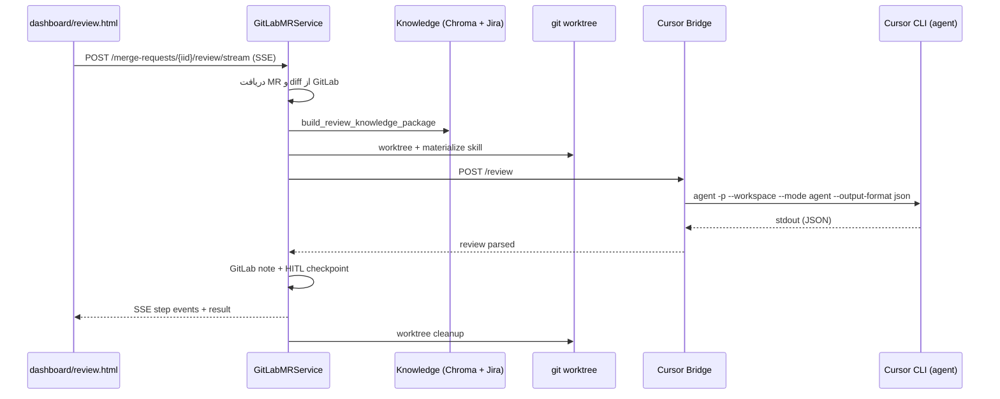

# Sentinel MR Review — ترتیب اجرا

این سند جریان کامل Review از کلیک دکمه **Review** در داشبورد تا نمایش نتیجه را شرح می‌دهد.

---

## نمای کلی



---

## نقطه ورود (Dashboard)

| مورد | مقدار |
|------|--------|
| صفحه | `/dashboard/review` → `src/dashboard/static/review.html` |
| دکمه | **Review** → `reviewMr()` |
| API (زنده) | `POST /api/v1/gitlab/merge-requests/{iid}/review/stream` |
| API (بدون stream) | `POST /api/v1/gitlab/merge-requests/{iid}/review` |
| پیش‌نمایش context | `GET /api/v1/gitlab/merge-requests/{iid}/review-context` |

با کلیک Review، داشبورد از endpoint **stream** استفاده می‌کند. هر مرحله به‌صورت رویداد SSE با `event: step` ارسال می‌شود و در بخش **Review Steps (live — not saved)** نمایش داده می‌شود. خروجی subprocess Cursor CLI (`stdout` / `stderr`) در بخش جداگانه **Cursor CLI Output** با `event: cli_output` نمایش داده می‌شود. این لاگ‌ها در DB یا فایل ذخیره **نمی‌شوند** (اما در `output_payload` run برای restore بعدی نگه داشته می‌شوند).

---

## مراحل اجرا (به ترتیب)

### 1. شروع — `start`

- Sentinel review برای MR مشخص (`!{iid}`) آغاز می‌شود.
- **کد:** `GitLabMRService.review_merge_request`

### 2. دریافت MR — `fetch_mr`

- فراخوانی GitLab API: `get_merge_request(iid)`
- بررسی وجود MR و **عدم وجود merge conflict**
- در صورت conflict → خطا و توقف

### 3. دریافت diff — `fetch_diff`

- `get_merge_request_changes(iiid)` — unified diff فایل‌های تغییر یافته
- تعداد فایل‌های تغییر یافته در لاگ step گزارش می‌شود

### 4. Knowledge Package — `knowledge`

- **کد:** `build_review_knowledge_package` در `src/slices/knowledge/review_package.py`
- منابع:
  - **PRD** از Jira (task key از title/branch)
  - **Code Specs**, **Review Rules** از ChromaDB
  - **Architecture Specs**, **ADR**, **Ubiquitous Language** (در صورت وجود)
  - **source_context** از diff / الگوهای کد
- در صورت ناقص بودن موارد اجباری → `KnowledgePackageError` (HTTP 400)

### 5. ثبت Run — `run`

- ایجاد رکورد run با `workflow_type: mr_code_review` و agent `sentinel`
- وضعیت → `RUNNING`
- **توجه:** این run در DB برای audit است؛ لاگ‌های زنده UI جداگانه و ephemeral هستند.

### 6. اجرای Sentinel — `sentinel`

- **کد:** `run_sentinel_review` → `execute_review` در `src/shared/agent_executors/review_executor.py`
- executor پیش‌فرض: `SENTINEL_EXECUTOR=cursor`

#### 6.1 ساخت Context — `build_context`

- **کد:** `build_review_context` در `src/shared/cursor_cli/context_builder.py`
- خروجی: `ReviewContext` شامل:
  - `git_diff` — diff فرمت‌شده MR (فشرده با RTK برای prompt)
  - `git_diff_raw` — diff خام برای scanner قطعی (RR-012/013/014)
  - `specs` — PRD / Code Specs (در صورت `CURSOR_REVIEW_INCLUDE_SPECS=true`)
  - `review_rules` — از knowledge package
  - `extra_context` — jira_ticket, branches, tech_stack
  - `use_review_skill: true` — وقتی worktree فعال است

#### 6.1b فشرده‌سازی Diff (RTK) — `rtk`

- **کد:** `src/shared/cursor_cli/rtk_compress.py`
- **شرط:** `CURSOR_REVIEW_USE_RTK=true` (پیش‌فرض: **false**)
- ترتیب: `rtk git diff` در worktree → `rtk diff` → fallback داخلی (trim context)
- `git_diff` → prompt LLM · `git_diff_raw` → `diff_rule_scanner`
- مستندات: [RTK_REVIEW.md](./RTK_REVIEW.md)

#### 6.2 Worktree (در صورت فعال بودن) — `worktree`, `git_fetch`, `git_worktree`

- **شرط:** `CURSOR_REVIEW_USE_WORKTREE=true` و `CURSOR_REPO_PATH` تنظیم شده
- **کد:** `ReviewWorkspaceSession` در `src/shared/cursor_cli/review_workspace.py`
- عملیات git (sync در thread):
  1. `git fetch origin {source_branch}`
  2. `git worktree add --detach {path} origin/{source_branch}`
- مسیر worktree: `{CURSOR_REVIEW_WORKTREE_ROOT یا ../.agentframework-review-worktrees}/mr-{iid}-{run_id}-…`
- timeout git: `CURSOR_REVIEW_GIT_TIMEOUT_SECONDS` (پیش‌فرض 90s)

#### 6.3 Materialize Skill — `skill_write`, `skill`

- خواندن Skill از Chroma: `get_review_skill()` — managed doc `sentinel-review-skill`
- نوشتن در worktree:
  ```
  .cursor/skills/sentinel-review/SKILL.md
  ```
- ویرایش Skill: **Knowledge Agent → Review Skill**

#### 6.4 ساخت Prompt — `prompt`

- **کد:** `build_skill_review_prompt` در `src/shared/cursor_cli/prompt_builder.py`
- prompt کوتاه: ارجاع به skill + embed کردن diff + قرارداد JSON
- Agent **نباید** فایل‌های دیگر workspace را browse کند (فقط diff)
- فرمت خروجی: `CURSOR_CLI_REVIEW_OUTPUT_FORMAT=json` (پیش‌فرض)

#### 6.5 Cursor Bridge — `cursor_bridge`

- HTTP POST به `{CURSOR_BRIDGE_URL}/review`
- **کد client:** `src/shared/agent_executors/cursor_client.py`
- payload: `context`, `workspace`, `model`, `mode`, `output_format`

#### 6.6 Cursor CLI (subprocess) — `cursor_cli`

- **کد:** `src/shared/cursor_cli/runner.py` → `run_cursor_review_request`
- دستور تقریبی (skill mode — diff-only، بدون `--workspace` وقتی `CURSOR_CLI_REVIEW_USE_WORKSPACE=false`):
  ```bash
  agent -p --trust --approve-mcps \
    --output-format json \
    --model composer-2.5 \
    "{prompt with git diff + review rules}"
  ```
  (`--mode agent` پیش‌فرض CLI است و معمولاً پاس داده نمی‌شود)
- Skill mode: **اول** mode تنظیم‌شده (`CURSOR_CLI_REVIEW_MODE`, پیش‌فرض `agent`) + json؛ اگر mode غیر از agent باشد، یک بار `agent+json` به‌عنوان fallback
- timeout review: `CURSOR_CLI_REVIEW_TIMEOUT_SECONDS` (پیش‌فرض **120s**؛ جدا از `CURSOR_CLI_TIMEOUT_SECONDS=300`)
- SSE heartbeat هر ۱۵s در مرحله `cursor_bridge` تا UI گیر نکند
- fallback اختیاری: 9Router اگر CLI در دسترس نباشد (`CURSOR_REVIEW_FALLBACK_9ROUTER`)

**چرا روی `cursor_bridge` گیر می‌کرد؟** worktree همیشه به CLI به‌عنوان `--workspace` پاس داده می‌شد (حتی با `CURSOR_CLI_REVIEW_USE_WORKSPACE=false`) + `--mode agent` → CLI کل workspace را index می‌کرد و تا ۵ دقیقه بدون log جدید می‌ماند. fix: diff در prompt است؛ `--workspace` فقط وقتی config=true باشد. همچنین ask-first در skill mode حذف شد تا زمان دو برابر نشود.

#### 6.7 Parse نتیجه — `parse`

- **کد:** `parse_review_response` در `src/shared/cursor_cli/response_parser.py`
- شکل JSON:
  ```json
  {
    "approved": true,
    "summary": "...",
    "findings": ["[ERROR] path/File.cs:12 - message"],
    "suggestions": ["[SUGGESTION] ..."]
  }
  ```
- پاسخ placeholder / Ask-mode → خطا (review ناقص)

#### 6.8 پاک‌سازی Worktree — `worktree_cleanup`

- `git worktree remove --force` + `git worktree prune`
- در `__aexit__` از `ReviewWorkspaceSession` — حتی در صورت خطا

### 7. GitLab Note — `gitlab_note`

- فرمت: `_format_review_note` — summary + findings + suggestions
- `create_merge_request_note(mr_iid, body)`

### 8. HITL — `hitl`

- checkpoint: `mr_review_approval`
- Tech Lead می‌تواند **Approve & Merge** یا **Request Changes** بزند

### 9. پایان — `done`

- run → `WAITING_HITL`
- پاسخ نهایی به UI: `review`, `review_prompt`, `hitl_checkpoint_id`, `note_posted`

---

## رویدادهای SSE (Dashboard)

| event | محتوا |
|-------|--------|
| `step` | `{ step, message, level, detail, at }` |
| `cli_output` | `{ stream: "stdout"\|"stderr", text, final, detail: { backend, returncode, timed_out, command }, at }` — خروجی subprocess Cursor CLI (پس از اتمام CLI؛ نه chunk-by-chunk) |
| `result` | همان پاسخ `MergeRequestReviewResponse` (شامل `cli_stdout`, `cli_stderr`, …) |
| `error` | `{ message, status }` |

---

## تنظیمات محیط (.env)

```env
# اجباری برای review با worktree + skill
CURSOR_REPO_PATH=D:\path\to\dizi
CURSOR_BRIDGE_URL=http://127.0.0.1:9090
SENTINEL_EXECUTOR=cursor

# Worktree + skill
CURSOR_REVIEW_USE_WORKTREE=true
# CURSOR_REVIEW_WORKTREE_ROOT=D:\path\to\review-worktrees
CURSOR_REVIEW_GIT_TIMEOUT_SECONDS=90

# Cursor CLI
CURSOR_CLI_BIN=agent
CURSOR_CLI_REVIEW_MODE=agent
CURSOR_CLI_REVIEW_OUTPUT_FORMAT=json
CURSOR_CLI_REVIEW_TIMEOUT_SECONDS=120
CURSOR_CLI_REVIEW_USE_WORKSPACE=false
CURSOR_CLI_TIMEOUT_SECONDS=300
CODE_REVIEW_MODEL=composer-2.5
```

Cursor Bridge را جدا اجرا کنید:

```bash
python run_cursor_bridge.py
```

---

## فایل‌های کلیدی

| فایل | نقش |
|------|-----|
| `src/dashboard/static/review.html` | UI + SSE consumer + Review Steps |
| `src/api/routes/gitlab_mrs.py` | REST + `/review/stream` |
| `src/api/services/gitlab_mr_service.py` | orchestration اصلی |
| `src/slices/knowledge/review_package.py` | Knowledge Package |
| `src/slices/knowledge/review_docs.py` | Skill / Rules / Prompt در Chroma |
| `src/shared/review/progress.py` | `ReviewProgressReporter` (SSE، بدون persist) |
| `src/shared/agent_executors/review_executor.py` | Cursor executor + worktree |
| `src/shared/cursor_cli/review_workspace.py` | git worktree + SKILL.md |
| `src/shared/cursor_cli/prompt_builder.py` | prompt skill-based |
| `src/shared/cursor_cli/runner.py` | subprocess `agent` |
| `src/cursor_bridge/server.py` | Bridge HTTP → CLI |

---

## حالت Fallback (بدون worktree)

اگر `CURSOR_REVIEW_USE_WORKTREE=false` یا `CURSOR_REPO_PATH` خالی باشد:

- worktree و skill materialize **انجام نمی‌شود**
- rules داخل prompt embed می‌شوند (حالت inline)
- `--workspace` به CLI پاس داده نمی‌شود (مگر `CURSOR_CLI_REVIEW_USE_WORKSPACE=true`)

---

## عیب‌یابی سریع

| علامت | احتمال |
|--------|--------|
| گیر روی `git_fetch` | branch روی origin نیست / شبکه / timeout |
| گیر روی `cursor_bridge` | CLI hang — معمولاً `agent+--workspace`؛ مطمئن شوید `CURSOR_CLI_REVIEW_USE_WORKSPACE=false` و heartbeat هر ۱۵s می‌آید |
| «Review did not run» | پاسخ placeholder از CLI — diff خالی یا mode اشتباه |
| HTTP 400 knowledge | PRD / code_specs / review_rules در Chroma ناقص |
| Conflict | MR قابل review نیست تا conflict حل شود |
